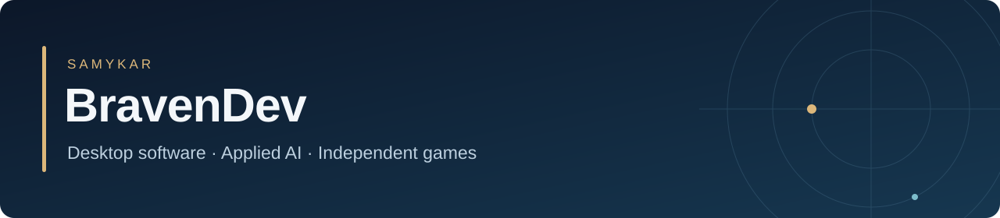

# SamYKar · BravenDev

Software developer working with **Python, JavaScript, and C++**. My projects range from offline business applications and local document research to browser games with custom physics, branching stories, and procedural audio.

[Project portfolio](https://github.com/SamYKarabacak/Portfolio) · [Games on itch.io](https://samykar.itch.io) · [Starkey Bridge Consulting](https://starkeybridgeconsulting.com)

## Recent desktop projects

| Project | What it does | Current checkpoint |
| --- | --- | --- |
| [SBC Parallel](https://github.com/SamYKarabacak/Portfolio/blob/main/projects/sbc-parallel.md) | Compare business workflows, queues, staffing, and capacity; export reproducible PDF and CSV reports. | Windows x64 · 1.0.1 |
| [SBC QuickQuote](https://github.com/SamYKarabacak/Portfolio/blob/main/projects/sbc-quickquote.md) | Create, save, and duplicate quotations with precise totals, PDF output, and local backups. | Windows x64 · 1.0.0 |
| [Quaymetric](https://github.com/SamYKarabacak/Portfolio/blob/main/projects/quaymetric.md) | Track transactions and invoices; work with budgets, cash plans, forecasts, and pricing. | Windows x64 · 1.0.0 |

These three commercial applications have packaged Windows builds. Native Windows acceptance checks remain pending; their source repositories are private.

## Public source projects

- **[SourceDesk](https://github.com/SamYKarabacak/SourceDesk)** — Search local documents, inspect source passages, and optionally use Ollama for answers with citations. Python, FastAPI, SQLite, and JavaScript.
- **[LedgerDesk](https://github.com/SamYKarabacak/LedgerDesk)** — Offline income and expense tracking with separate currency views, CSV exports, and backups. Python, Tkinter, and SQLite.
- **[SLINGSHIFT](https://github.com/SamYKarabacak/SLINGSHIFT)** — An orbital puzzle game with twelve levels, trajectory prediction, and a shared physics model. C++20, raylib, and WebAssembly.
- **[THE LAST MESSAGE](https://github.com/SamYKarabacak/THE-LAST-MESSAGE)** — A branching psychological horror game with four endings, local saves, and Web Audio sound.

## Games and research in progress

**[DON’T OPEN THE DOOR](https://github.com/SamYKarabacak/Portfolio/blob/main/projects/dont-open-the-door.md)** is a five-scene psychological horror project with four endings, environmental interactions, and persistent story progress. Current development checkpoint: **0.1.28**.

**[PULZIX](https://samykar.itch.io/pulzix)** is a timing game with a full browser edition and a separate free demo. Its commercial source is private.

My **[AI reliability research](https://github.com/SamYKarabacak/Portfolio/blob/main/projects/identifier-extraction-research.md)** examines exact identifier extraction and source selection in synthetic records. The manuscript is in preparation; a current-model extension is prepared but has no new model results.

Each repository documents its own license, setup, and verification scope.
